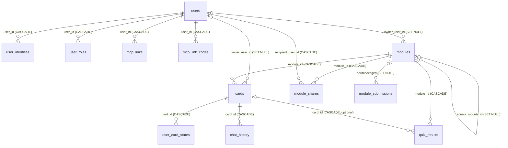

# Database Schema (PostgreSQL)

PostgreSQL is the reference and production database (Docker, Azure, IIS); SQLite is used for local development ([ADR 0004](adr/0004-datenbank-abstraktion.en.md)). Source of truth: [Schema.cs](../src/LearnCards.Web/Data/Schema.cs) and migrations in [PostgresDatabase.cs](../src/LearnCards.Web/Data/PostgresDatabase.cs) (`InitAsync`).

## Overview: What Belongs to a User?

- **Private/user-scoped:** `modules`, `cards` (owner `owner_user_id`); `user_preferences`, `user_card_states`, `chat_history`, `quiz_results` (scoped by `user_sub`), and `mcp_links`.
- **User management:** `users`, `user_identities`, `user_roles`, `audit_log`.
- **Explicit sharing ([ADR 0015](adr/0015-freigaben-globale-lernmodule.en.md)):** `module_shares` (personal revocable shares) and global `modules.scope='global'` (ownerless snapshots approved from `module_submissions`). Private collections stay isolated, with no unrestricted common card collection. Unassigned legacy modules (`owner_user_id IS NULL` **and** `scope='private'`) are visible only to administrators.
- Isolation review: [review report](reviews/2026-10-24-mehrbenutzer-pruefbericht.en.md).

## Conventions

- IDs use PostgreSQL `UUID` (SQLite `TEXT`), generated server-side as GUID strings.
- Timestamps are **ISO-8601 strings** (`yyyy-MM-ddTHH:mm:ss.fffZ`, UTC), not `timestamptz` columns.
- Booleans are `INTEGER` 0/1; JSON is stored as `TEXT` (not `jsonb`).
- All values use the text wire format (`DbValue`); **always** bind `@name` parameters.
- Since [ADR 0011](adr/0011-mehrbenutzerarchitektur.en.md), `user_sub` holds **internal user ID** (`users.id`) without a foreign key. Earlier it stored external IdP subject; migration rewrites this on first login.
- `owner_user_id=NULL` for legacy unassigned modules/cards (admin-only).

## ER Diagram

`user_preferences` and `audit_log` have no foreign keys (`user_sub`/`actor_user_id` identify users as text).

## Tables

### users

Application users with stable internal IDs ([ADR 0011](adr/0011-mehrbenutzerarchitektur.en.md)).

| Column | Type | Notes |
|---|---|---|
| id | UUID PK | Internal user ID (cookie claim `uid`) |
| display_name | TEXT NOT NULL | User-editable |
| email | TEXT NOT NULL | Default `''`, from IdP |
| status | TEXT NOT NULL | `active` or `disabled` |
| legacy_migrated | INTEGER NOT NULL | 1 if legacy `user_sub` external subject values were rewritten |
| created_at, last_login_at | TEXT NOT NULL | |

### user_identities

| Column | Type | Notes |
|---|---|---|
| provider | TEXT NOT NULL | OIDC issuer or `dev`; part of primary key |
| subject | TEXT NOT NULL | IdP `sub`, part of PK |
| user_id | UUID NOT NULL | FK → users, `CASCADE` |
| created_at | TEXT NOT NULL | |

Index: `ix_user_identities_user (user_id)`.

### user_roles

| Column | Type | Notes |
|---|---|---|
| user_id | UUID NOT NULL | FK → users, `CASCADE`; part of PK |
| role | TEXT NOT NULL | `user`, `admin`, `auditor` (later also `themen_admin` under ADR 0029); part of PK |
| granted_by | TEXT NULL | Grantor user ID, `bootstrap` (`ADMIN_SUBJECTS`), or `idp` (Entra app role, [ADR 0012](adr/0012-rollen-aus-entra-app-roles.en.md)) |
| granted_at | TEXT NOT NULL | |

### module_shares

Personal module sharing ([ADR 0015](adr/0015-freigaben-globale-lernmodule.en.md)).

| Column | Type | Notes |
|---|---|---|
| id | UUID PK | |
| module_id | UUID NOT NULL | FK → modules, `CASCADE` |
| recipient_user_id | UUID NOT NULL | FK → users, `CASCADE`; index `ix_module_shares_recipient` |
| shared_by_user_id | TEXT NOT NULL | Granting owner |
| created_at | TEXT NOT NULL | |
| revoked_at | TEXT NULL | Set upon revocation; access ceases, results remain |

Unique: `(module_id, recipient_user_id)`.

### module_submissions

Submissions for global publication.

| Column | Type | Notes |
|---|---|---|
| id | UUID PK | |
| publication_id | UUID NOT NULL | New or existing publication |
| kind | TEXT NOT NULL | `new` or `update` |
| source_module_id | UUID NULL | FK → modules, `SET NULL`: private original |
| staged_module_id | UUID NULL | FK → modules, `SET NULL`: frozen copy (`global_status='staged'`) |
| submitter_user_id | UUID NULL | FK → users, `SET NULL` |
| submitter_name, module_name | TEXT NOT NULL | Snapshot |
| card_count, version | INTEGER NOT NULL | |
| status | TEXT NOT NULL | `pending`, `approved`, `rejected` |
| reason | TEXT NOT NULL | Rejection reason |
| submitted_at, decided_at | TEXT | |
| decided_by | TEXT NULL | Administrator ID |

Index: `ix_module_submissions_status (status, submitted_at)`.

### mcp_links

User-bound MCP access ([ADR 0013](adr/0013-mcp-benutzergebundene-anmeldung.en.md)); never stores plaintext tokens.

| Column | Type | Notes |
|---|---|---|
| id | UUID PK | |
| user_id | UUID NOT NULL | FK → users, `CASCADE`; `ix_mcp_links_user` |
| name | TEXT NOT NULL | Client name or user-defined label |
| kind | TEXT NOT NULL | `oauth` or `token` |
| token_hash | TEXT NOT NULL UNIQUE | **HMAC-SHA-256** hex of `lcm_…` using `.env` key (`hash_alg='hmac1'`); legacy `sha256` upgraded on first use ([ADR 0025](adr/0025-sichere-speicherung-von-mcp-tokens.en.md)) |
| token_hint | TEXT NOT NULL | `#abcd` derived from row ID; **not token content** |
| created_at, expires_at | TEXT NOT NULL | |
| last_used_at, revoked_at | TEXT NULL | Revocation sets `revoked_at`, recomputes `row_mac` |
| hash_alg | TEXT NOT NULL | `hmac1` or legacy `sha256` (valid until `MCP_LEGACY_TOKEN_UNTIL`) |
| key_id | TEXT NOT NULL | Derived eight-hex key ID, used in rotation |
| row_mac | TEXT NOT NULL | HMAC over id/user/kind/hash/timestamps/revocation/key ID (whole UTC seconds); verified **before all other checks**, mismatch → 401 + `mcp.token.integrity_failure` audit |

### mcp_link_codes

Single-use user-consent codes (valid five minutes; MCP server exchanges using service key only).

| Column | Type | Notes |
|---|---|---|
| code_hash | TEXT PK | **HMAC-SHA-256** hex with `.env` key (ADR 0025) |
| user_id | UUID NOT NULL | FK → users, `CASCADE`, consenting user |
| client_name | TEXT NOT NULL | |
| created_at, expires_at | TEXT NOT NULL | |
| key_id, row_mac | TEXT NOT NULL | Key ID and row HMAC over code_hash/user/client/created/expiry/key ID |
| used_at | TEXT NULL | Set atomically on exchange, one-use |

### mcp_oauth_clients

Dynamically registered **public** MCP OAuth clients (e.g., Claude), persisted across restarts ([ADR 0025](adr/0025-sichere-speicherung-von-mcp-tokens.en.md)). Service-key-only API `POST/GET /api/mcp/oauth/clients`.

| Column | Type | Notes |
|---|---|---|
| client_id | TEXT PK | `learncards-<32 hex>` |
| key_id | TEXT NOT NULL | Key identifier |
| record_enc | TEXT NOT NULL | **AES-256-GCM encrypted** JSON (name, redirect URIs, scopes, etc.), `client_id` as AAD, format `v1.<nonce>.<ciphertext+tag>` Base64url |
| created_at | TEXT NOT NULL | Unused clients expire after 30 days; max 1,000 |
| last_used_at | TEXT NULL | Updated no more than once per day |
| row_mac | TEXT NOT NULL | HMAC over client_id/key_id/record_enc/created_at |

### audit_log

Administrative action log (roles, disablement, ownership assignment, user creation).

| Column | Type | Notes |
|---|---|---|
| id | UUID PK | |
| actor_user_id | TEXT NULL | NULL means system/bootstrap |
| action | TEXT NOT NULL | e.g., `role.grant`, `role.revoke`, `user.disable`, `module.assign-owner` |
| target | TEXT NOT NULL | Target ID |
| detail | TEXT NOT NULL | |
| created_at | TEXT NOT NULL | `ix_audit_log_created` index |

### modules

| Column | Type | Notes |
|---|---|---|
| id | UUID PK | |
| name | TEXT NOT NULL UNIQUE | Logical legacy declaration; ownership uniqueness enforced below |
| description | TEXT NOT NULL | Default `''` |
| icon | TEXT NOT NULL | Default `📚` |
| color | TEXT NOT NULL | Default `#2AA79B` |
| owner_user_id | UUID NULL | FK users, `SET NULL`; NULL means global/unassigned |
| scope | TEXT NOT NULL | `private` (default), `global` (later `topic` frozen) |
| publication_id | UUID NULL | Stable global publication ID |
| global_version | INTEGER NULL | Publication version number |
| global_status | TEXT NULL | `staged`, `active`, `superseded`, `deactivated` |
| source_module_id | UUID NULL | FK → modules `SET NULL`, private source |
| source_owner_user_id | UUID NULL | FK → users `SET NULL`, original author |
| source_owner_name | TEXT NULL | Snapshot display name at submission |
| published_at, published_by | TEXT NULL | Publication timestamp/admin |
| created_at, updated_at | TEXT NOT NULL | ISO-8601 |

Only `scope='global'` with `global_status='active'` is available to all learners. Historical original policy: never delete global versions (ADR 0015 subsequently adds explicit admin-only deletion). Indexes: `ix_modules_scope(scope,global_status)`, `ix_modules_publication`, `ix_modules_owner`; names are unique **per owner** (`ux_modules_owner_name(owner_user_id,name)`), not globally. Later ADR 0028 adds optional `reference_id` (details below).

### cards

| Column | Type | Notes |
|---|---|---|
| id | UUID PK | |
| module_id | UUID NOT NULL | FK modules, `ON DELETE CASCADE` |
| owner_user_id | UUID NULL | FK users, `SET NULL`; same as module owner |
| category, term, question, definition | TEXT NOT NULL | |
| how_it_works, context, key_fact | TEXT NOT NULL | Default `''` |
| reference_answer | TEXT NOT NULL | Default `''`, model answer |
| chat_prompt | TEXT NOT NULL | Default `''` |
| official_sources_json | TEXT NOT NULL | Default `'[]'`, array `{title,url,publisher}` |
| slide_number | INTEGER NULL | Slide mode ([ADR 0010](adr/0010-folienmodus-und-karten-quiz.en.md)) |
| target_time_sec | INTEGER NULL | Target time per slide |
| quiz_json | TEXT NOT NULL | Default `'[]'`, card `quiz[]` canonical import/export and source of truth for `card_json` questions |
| quiz_synced | INTEGER NOT NULL | Default 0; 1 when card quiz is projected to pool (ADR 0019) |
| images_json | TEXT NOT NULL | Default `'[]'`, legacy inline Base64 (ADR 0016); preserved unchanged and migrated to `card_images` at startup |
| images_migrated | INTEGER NOT NULL | Default 0; 1 when migrated to `card_images` (ADR 0017) |
| archived | INTEGER NOT NULL | Default 0; soft delete |
| sort_order | INTEGER NOT NULL | Default 0 |
| created_at, updated_at | TEXT NOT NULL | |

Indexes: `ix_cards_module(module_id)`, `ix_cards_category(module_id,category)`, `ix_cards_owner(owner_user_id)`.

### card_images

Image metadata (ADR 0017); bytes live in storage providers, delivered only via `/api/images/{id}` (ADR 0018).

| Column | Type | Notes |
|---|---|---|
| id | TEXT PK | GUID `image_id` exposed to API |
| card_id | TEXT NOT NULL | FK `cards(id)` `ON DELETE CASCADE` |
| provider | TEXT NOT NULL | `database`, `local`, `azureblob`, `s3`, `sharepoint`; migration changes provider |
| storage_key | TEXT NOT NULL | Server-generated 32 hex, never client supplied; may be shared by rows (dedup/global copies) |
| mime_type | TEXT NOT NULL | PNG/JPEG/WebP MIME |
| size_bytes | INTEGER NOT NULL | |
| checksum | TEXT NOT NULL | SHA-256 hex, checked on every storage read |
| alt_text, caption | TEXT NOT NULL | Default `''`; max 300 characters |
| sort_order | INTEGER NOT NULL | Default 0 |
| created_at | TEXT NOT NULL | |

Indexes: `ix_card_images_card(card_id)`, `ix_card_images_blob(provider,storage_key)`. **Never stored:** SAS, signatures, credentials, download URLs.

### image_blobs

Only for provider `database`: `storage_key TEXT PK`, `data_base64 TEXT NOT NULL` (text-based `IDatabase`), `size_bytes INTEGER NOT NULL`, `created_at TEXT NOT NULL`. Delete when no `card_images` row references the object.

### user_preferences

| Column | Type | Notes |
|---|---|---|
| user_sub | TEXT PK | Internal user ID |
| theme | TEXT NOT NULL | Default `''` |
| updated_at | TEXT NOT NULL | |

### user_card_states

| Column | Type | Notes |
|---|---|---|
| user_sub | TEXT NOT NULL | Part of PK |
| card_id | UUID NOT NULL | Part of PK, FK cards `CASCADE` |
| is_checked | INTEGER NOT NULL | Default 0 |
| marked_review | INTEGER NOT NULL | Default 0 |
| updated_at | TEXT NOT NULL | |

Index: `ix_user_card_states_user(user_sub,card_id)`.

### chat_history

| Column | Type | Notes |
|---|---|---|
| id | UUID PK | |
| user_sub | TEXT NOT NULL | |
| card_id | UUID NOT NULL | FK cards, `CASCADE` |
| original_question, normalized_question, assistant_answer | TEXT NOT NULL | Default `''` |
| created_at | TEXT NOT NULL | |

Index: `ix_chat_history_user_card(user_sub,card_id,created_at)`.

### quiz_results

| Column | Type | Notes |
|---|---|---|
| id | UUID PK | |
| module_id | UUID NOT NULL | FK modules, `CASCADE` |
| card_id | UUID NULL | FK cards, `CASCADE`; populated for single-card quiz |
| user_sub | TEXT NOT NULL | |
| category | TEXT NOT NULL | |
| score, max_score | DOUBLE PRECISION NOT NULL | |
| grade | TEXT NOT NULL | |
| feedback | TEXT NOT NULL | Default `''` |
| answers_json | TEXT NOT NULL | Default `'[]'` |
| stats_json | TEXT NOT NULL | Default `'{}'` |
| context | TEXT NOT NULL | `private` (default), `shared`, `global`, depending on learning context (ADR 0015) |
| session_id | TEXT NULL | Session for server-verified result (ADR 0019); NULL for legacy/sessionless clients |
| passed | INTEGER NULL | 1/0 at attempted threshold; NULL legacy |
| pass_percent | INTEGER NULL | Passing threshold at attempt |
| module_version | INTEGER NULL | Global module version; NULL for private |
| completed_at | TEXT NOT NULL | |

Index `ix_quiz_user(user_sub,completed_at)`; global result `module_id` points to exact published version.

### quiz_configs

One configuration per module/frozen version (ADR 0019); absence means backward-compatible defaults.

| Column | Type | Notes |
|---|---|---|
| module_id | UUID PK | FK modules, `CASCADE` |
| config_json | TEXT NOT NULL | snake_case: `enabled`, `allow_multiple_choice`, `origin`, `strategy`, `single_choice`, `multiple_response`, `free_text`, `question_count`, `shuffle_questions`, `shuffle_answers`, `scope`, `pass_percent`, `allow_retry`, `show_correct_answers` |
| updated_at | TEXT NOT NULL | |

### quiz_questions

Persistent per-module/version question pool, optionally tied to card.

| Column | Type | Notes |
|---|---|---|
| id | UUID PK | |
| module_id | UUID NOT NULL | FK modules `CASCADE` |
| card_id | UUID NULL | FK cards `CASCADE` |
| type | TEXT NOT NULL | `single_choice`, `multiple_response`, `free_text` |
| question | TEXT NOT NULL | |
| options_json | TEXT NOT NULL | JSON option array, free-text `[]` |
| correct_json | TEXT NOT NULL | Zero-based correct-index array |
| explanation | TEXT NOT NULL | Rationale, or model answer for free text |
| origin | TEXT NOT NULL | `manual` or `ai` |
| source | TEXT NOT NULL | `card_json` (projection), `ai`, `editor` |
| active | INTEGER NOT NULL | Default 1; disable does not delete results |
| module_version | INTEGER NULL | Global version |
| fingerprint | TEXT NOT NULL | Hash of card/type/text/options/correct options, prevents duplicate |
| created_at, updated_at | TEXT NOT NULL | |

Indexes: unique `ux_quiz_questions_fp(module_id,fingerprint)`, `ix_quiz_questions_card(card_id)`.

### quiz_sessions

Server-side sessions containing answers for verified grading. Valid four hours (submit afterward 410); sessions older than 24 h removed at startup and at most every 10 minutes in batches. `quiz_results` has no FK to sessions and survives cleanup.

| Column | Type | Notes |
|---|---|---|
| id | UUID PK | `session_id` |
| user_sub | TEXT NOT NULL | Session owner; foreign session → not found |
| module_id | UUID NOT NULL | FK modules `CASCADE` |
| card_id | UUID NULL | FK cards `CASCADE`, card quiz |
| category | TEXT NOT NULL | |
| context | TEXT NOT NULL | `private`/`shared`/`global` |
| module_version | INTEGER NULL | |
| config_json | TEXT NOT NULL | Config snapshot at start |
| questions_json | TEXT NOT NULL | Questions with solutions, including ephemeral |
| status | TEXT NOT NULL | `open` or `submitted`, atomic single submission |
| created_at | TEXT NOT NULL | |

Index: `ix_quiz_sessions_user(user_sub,created_at)`.

> **ADR 0020:** Rich text/card editor require **no schema changes**. Markup resides in `definition`, `how_it_works`, `context`, `key_fact`, `reference_answer`, and ordering in `cards.sort_order`.

### certificates, anchor_batches, app_settings

Credential and blockchain tables (ADRs 0021–0022) are added using `CREATE TABLE IF NOT EXISTS` without changing old tables.

- **certificates:** `id`, unique `number`, `user_id` (FK users, CASCADE), `module_id` (no FK, survives module deletion), `module_name`, `module_version` (0 non-global), `module_scope` (`private|shared|global`), `result_id`, `learner_name`, `score_percent`, `pass_percent`, `issued_at`, `badge_jws` (signed VC-JWT), `badge_hash` (JWS SHA-256), `leaf_hash` (Merkle leaf), `status` (`active|revoked`), `revoked_at/_reason/_by`, `chain_status` (`none|pending|batched|cost_blocked|anchoring|confirmed|failed`), `chain_network`, `chain_id` (network **at issue**), `batch_id` (FK anchor_batches, SET NULL), `merkle_proof_json`, `chain_error`, `chain_attempts`, `chain_updated_at`, `anchored_at`. Unique `(user_id,module_id,module_version)`; indexes by chain status, user, batch.
- **anchor_batches:** `id`, `network`, `chain_id`, `merkle_root` (unique per network), `leaf_count`, `status` (`planned|cost_blocked|submitted|confirmed|failed`), `tx_hash`, `nonce`, `raw_tx` (signed transaction used for identical retries, not a secret), `block_number`, `gas_limit`, `gas_used`, `max_fee_per_gas`, `effective_gas_price`, `fee_wei`, `rate_eur_per_pol`, `rate_at`, `est_total_eur`, `fee_eur` (0 for testnet/simulation), `cost_per_cert_eur`, `simulated_cost_eur`, `saved_eur`, `simulated`, `error`, `attempts`, timestamps. Large wei numbers stored as text.
- **app_settings:** `name` PK, `value`, `updated_at`, `updated_by`: administrative configuration (`chain.*`, mainnet approval), **never secrets**.

## Schema Initialization and Migrations

At startup (`PostgresDatabase.InitAsync`, serialized through a gate):

1. `Schema.Statements("postgres")` creates tables/indexes using `CREATE TABLE/INDEX IF NOT EXISTS`.
2. `MigrateLegacySchemaAsync` converts `cards.archived` from `boolean` to `INTEGER`.
3. `MigrateCardContentColumnsAsync` adds `reference_answer`, `official_sources_json`, `slide_number`, `target_time_sec`, `quiz_json`, `quiz_synced` (ADR 0019).
4. `MigrateQuizResultColumnsAsync` adds nullable `quiz_results.card_id`, `stats_json`, `session_id`, `passed`, `pass_percent`, `module_version`. `quiz_configs`, `quiz_questions`, `quiz_sessions` are created using `IF NOT EXISTS`; `CardRepository.SyncLegacyQuizAsync` idempotently imports existing `quiz[]` to pool on startup.
5. `MigrateModuleDeleteCascadeAsync` establishes `ON DELETE CASCADE` module FKs.
6. `MigrateCardContentColumnsAsync` also adds `cards.images_json` (default `'[]'`, legacy image-less) and `cards.images_migrated` (default 0). `card_images`/`image_blobs` created through `IF NOT EXISTS`; `CardImageService.MigrateLegacyInlineImagesAsync` migrates inline images once and retains original `images_json` unchanged.
7. `MigrateSharingAsync` (ADR 0015) adds columns to `modules`, `quiz_results.context` with DEFAULT/NULL (existing remains `private`), then adds `ix_modules_scope`/`ix_modules_publication`; `module_shares`/`module_submissions` created with `IF NOT EXISTS`.
8. `MigrateOwnershipAsync` (ADR 0011) adds `owner_user_id` to modules/cards, removes `modules_name_key` and creates ownership indexes **after** column migration.

Existing `owner_user_id` values remain NULL; ownership is **never assigned automatically**. Admins explicitly assign it under `/admin`. `UserService.SignInAsync` migrates `user_sub` from external subject to internal ID on first login.

**Rollback:** Back up database before rollout (`pg_dump`). Migration deletes nothing; new columns/tables may be unused by older binaries. After `user_sub` changes to internal IDs, old binaries would not match them to existing external users.

**No migration framework or version table:** Each migration checks `information_schema`/`pg_constraint` for necessity and must be idempotent ([ADR 0004](adr/0004-datenbank-abstraktion.en.md)). SQLite equivalents are in `SqliteDatabase.InitAsync` (`EnsureColumn`), and `SqliteDatabase.MigrateOwnership` rebuilds `modules` using the official 12-step procedure because inline `UNIQUE(name)` cannot be removed via ALTER.

## Operations

- Custom PostgreSQL v3 wire protocol (SCRAM-SHA-256/MD5/plaintext), `POSTGRES_SSLMODE=disable|prefer|require` (Azure: `require`); one serialized connection and one reconnect on failure.
- Docker: `postgres:16-alpine`, `postgres_data` volume, configured using `POSTGRES_HOST/PORT/USER/PASSWORD/DB`.
- Backup/restore happens outside app using database-level `pg_dump`.

### Topics (ADR 0027)

Ten new tables through `CREATE TABLE IF NOT EXISTS` for both providers. **No foreign keys to `modules`**, so topic versions survive deletion of sources:

- **topics:** `id`, `owner_user_id`, `name` (owner-unique), `description`, `status=active|archived`, `draft_revision`, `published_revision`, timestamps.
- **topic_modules:** composite PK `(topic_id,module_id)`, `sort_order`; one module may belong to many topics; index `ix_topic_modules_module`.
- **topic_exam_configs:** `topic_id` PK, FK topics CASCADE, `config_json` (module/final exams).
- **topic_questions:** topic-specific questions with `topic_id`, `options_json`, `correct_json`, `active`, etc.; index `(topic_id,active)`.
- **topic_versions:** `id`, `topic_id`, `version_number` (unique with `topic_id`), `snapshot_json`, `global_status=none|pending_approval|active|superseded|rejected|deactivated`, `decision_reason`, publication/decision timestamps; index `(global_status,topic_id)`.
- **topic_version_modules:** PK `(version_id,module_id)`, frozen copy with `content_hash`; `ix_topic_version_modules_module`.
- **topic_shares:** user shares, unique `(topic_id,target_user_id)`, revocation, index `(target_user_id,revoked_at)`.
- **topic_assignments:** assigned tasks unique `(topic_id,user_id)`, `assigned_by`, `assigned_at`, `status`, index `(user_id,status)`.
- **topic_user_state:** PK `(topic_id,user_id)`, last seen version, `last_activity_at`.
- **topic_exam_attempts:** unique quiz `session_id`, user/topic/version/module or final exam, indexes `(user_id,topic_id)`, `(topic_id,topic_version)`.

Frozen modules live in `modules`/`cards` using `scope='topic'` and NULL owner. See `Data/Schema.cs` (`TopicStatements`).

> **ADR 0028:** Optional `modules.reference_id TEXT NULL` is a stable GUID for module/topic JSON, owner-specific unique index `ux_modules_owner_reference(owner_user_id,reference_id)`, generated at first export, migrated idempotently using `EnsureColumn` (SQLite) or `EnsureTableColumnAsync` (PostgreSQL). Cloning/import/MCP topic management add **no further tables or columns**; they use existing module/card/image/quiz/topic tables. Imported/cloned modules are ordinary private modules.

> **ADR 0029:** Three additional `topic_assignments` columns: `topic_version INTEGER NULL` (specific assigned version, legacy NULL means latest published), `mandatory INTEGER NOT NULL DEFAULT 1` (1 mandatory, 0 optional), `due_at TEXT NULL`. Idempotent migration with SQLite `EnsureColumn` and PostgreSQL `EnsureTableColumnAsync`; legacy assignments remain mandatory. `user_roles.role` also recognizes `themen_admin`. Progress/status are computed without new tables.
