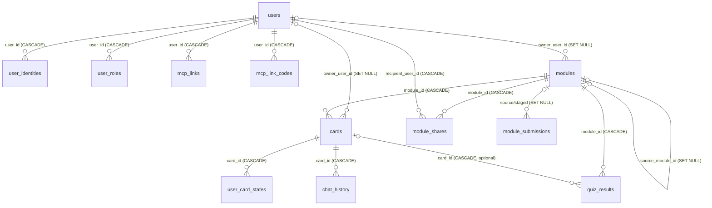

# Datenbankschema (PostgreSQL)

PostgreSQL ist die Referenz- und Produktionsdatenbank (Docker, Azure, IIS); SQLite dient nur der lokalen Entwicklung
([ADR 0004](adr/0004-datenbank-abstraktion.md)). Die Quelle der Wahrheit ist
[Schema.cs](../src/LearnCards.Web/Data/Schema.cs) plus die Migrationen in
[PostgresDatabase.cs](../src/LearnCards.Web/Data/PostgresDatabase.cs) (`InitAsync`).

## Überblick: was ist benutzerbezogen?

- **Benutzerbezogen (privat):** `modules` und `cards` (Eigentümer `owner_user_id`), `user_preferences`, `user_card_states`, `chat_history`, `quiz_results` (je `user_sub`), `mcp_links`.
- **Benutzerverwaltung:** `users`, `user_identities`, `user_roles`, `audit_log`.
- **Explizit geteilt ([ADR 0015](adr/0015-freigaben-globale-lernmodule.md)):** `module_shares` (persönliche, widerrufbare Freigaben) und globale Module (`modules.scope = 'global'`, ohne Eigentümer, aus einer geprüften Einreichung `module_submissions`).
  Private Bestände bleiben isoliert; einen frei zugänglichen gemeinsamen Kartenbestand gibt es nicht. Unzugeordneter Altbestand (`owner_user_id IS NULL` **und** `scope = 'private'`) ist nur für Administratoren sichtbar.
- Bewertung der Trennung: [Prüfbericht](reviews/2026-10-24-mehrbenutzer-pruefbericht.md).

## Konventionen

- IDs sind `UUID` (SQLite: `TEXT`), serverseitig als Guid-String erzeugt.
- Zeitstempel sind **ISO-8601-Text** (`yyyy-MM-ddTHH:mm:ss.fffZ`, UTC), keine `timestamptz`-Spalten.
- Booleans sind `INTEGER` 0/1; JSON-Inhalte liegen als `TEXT` (kein `jsonb`).
- Alle Werte laufen im Text-Wireformat (`DbValue`); Parameter immer als `@name` gebunden.
- `user_sub` enthält seit [ADR 0011](adr/0011-mehrbenutzerarchitektur.md) die **interne Benutzer-ID** (`users.id`), **ohne** Fremdschlüssel.
  Vor ADR 0011 stand dort das externe IdP-Subject; Altdaten werden beim ersten Login der Identität umgeschrieben.
- `owner_user_id` (Module, Karten) ist `NULL` für unzugeordneten Altbestand; dieser ist nur für Administratoren sichtbar.

## ER-Diagramm

`user_preferences` und `audit_log` haben keine Fremdschlüssel (Benutzerbezug über `user_sub` bzw. `actor_user_id` als Text).

## Tabellen

### users
Anwendungsbenutzer mit stabiler interner ID ([ADR 0011](adr/0011-mehrbenutzerarchitektur.md)).

| Spalte | Typ | Hinweis |
|---|---|---|
| id | UUID PK | interne Benutzer-ID (Claim `uid`) |
| display_name | TEXT NOT NULL | vom Benutzer änderbar |
| email | TEXT NOT NULL | Default `''`, vom IdP übernommen |
| status | TEXT NOT NULL | `active` oder `disabled` |
| legacy_migrated | INTEGER NOT NULL | 1 = Altdaten (`user_sub` = externes Subject) wurden auf diese ID umgeschrieben |
| created_at, last_login_at | TEXT NOT NULL | |

### user_identities
| Spalte | Typ | Hinweis |
|---|---|---|
| provider | TEXT NOT NULL | OIDC-Issuer-URL oder `dev` — Teil des PK |
| subject | TEXT NOT NULL | IdP-`sub` — Teil des PK |
| user_id | UUID NOT NULL | FK → users, `CASCADE` |
| created_at | TEXT NOT NULL | |

Index: `ix_user_identities_user (user_id)`.

### user_roles
| Spalte | Typ | Hinweis |
|---|---|---|
| user_id | UUID NOT NULL | FK → users, `CASCADE` — Teil des PK |
| role | TEXT NOT NULL | `user`, `admin` oder `auditor` — Teil des PK |
| granted_by | TEXT NULL | Benutzer-ID des Vergebenden, `bootstrap` (ADMIN_SUBJECTS) oder `idp` (Entra-App-Rolle, [ADR 0012](adr/0012-rollen-aus-entra-app-roles.md)) |
| granted_at | TEXT NOT NULL | |

### module_shares
Persönliche Modulfreigaben ([ADR 0015](adr/0015-freigaben-globale-lernmodule.md)).

| Spalte | Typ | Hinweis |
|---|---|---|
| id | UUID PK | |
| module_id | UUID NOT NULL | FK → modules, `CASCADE` |
| recipient_user_id | UUID NOT NULL | FK → users, `CASCADE`; Index `ix_module_shares_recipient` |
| shared_by_user_id | TEXT NOT NULL | Eigentümer, der freigegeben hat |
| created_at | TEXT NOT NULL | |
| revoked_at | TEXT NULL | gesetzt = Freigabe widerrufen (Zugriff endet, Ergebnisse bleiben) |

`UNIQUE (module_id, recipient_user_id)`.

### module_submissions
Einreichungen zur globalen Veröffentlichung.

| Spalte | Typ | Hinweis |
|---|---|---|
| id | UUID PK | |
| publication_id | UUID NOT NULL | Veröffentlichung (neu oder bestehend) |
| kind | TEXT NOT NULL | `new` oder `update` |
| source_module_id | UUID NULL | FK → modules, `SET NULL`: privates Original |
| staged_module_id | UUID NULL | FK → modules, `SET NULL`: eingefrorene Kopie (`global_status = 'staged'`) |
| submitter_user_id | UUID NULL | FK → users, `SET NULL` |
| submitter_name, module_name | TEXT NOT NULL | Snapshot |
| card_count, version | INTEGER NOT NULL | |
| status | TEXT NOT NULL | `pending`, `approved`, `rejected` |
| reason | TEXT NOT NULL | Begründung der Ablehnung |
| submitted_at, decided_at | TEXT | |
| decided_by | TEXT NULL | Administrator-ID |

Index: `ix_module_submissions_status (status, submitted_at)`.

### mcp_links
Benutzergebundene MCP-Zugänge ([ADR 0013](adr/0013-mcp-benutzergebundene-anmeldung.md)). Das Token selbst wird nie gespeichert.

| Spalte | Typ | Hinweis |
|---|---|---|
| id | UUID PK | |
| user_id | UUID NOT NULL | FK → users, `CASCADE`; Index `ix_mcp_links_user` |
| name | TEXT NOT NULL | Clientname bzw. frei gewählter Name |
| kind | TEXT NOT NULL | `oauth` oder `token` |
| token_hash | TEXT NOT NULL UNIQUE | **HMAC-SHA-256** (hex) des Tokens `lcm_…` mit einem Schlüssel aus der `.env` (`hash_alg='hmac1'`); Altbestand: reiner SHA-256 (`hash_alg='sha256'`), wird beim ersten Gebrauch umgestellt ([ADR 0025](adr/0025-sichere-speicherung-von-mcp-tokens.md)) |
| token_hint | TEXT NOT NULL | Kennung `#abcd` aus der Zeilen-ID — **keine** Token-Teile |
| created_at, expires_at | TEXT NOT NULL | |
| last_used_at, revoked_at | TEXT NULL | Widerruf setzt `revoked_at` (und berechnet `row_mac` neu) |
| hash_alg | TEXT NOT NULL | `hmac1` (neu) oder `sha256` (Altbestand, befristet bis `MCP_LEGACY_TOKEN_UNTIL`) |
| key_id | TEXT NOT NULL | Kennung des Schlüssels (8 Hex, abgeleitet; für Rotation) |
| row_mac | TEXT NOT NULL | HMAC über id, user_id, kind, token_hash, created_at, expires_at, revoked_at, key_id (ganze Sekunden, UTC). Wird bei **jedem** Aufruf vor allem anderen geprüft; Abweichung = 401 + Audit `mcp.token.integrity_failure` |

### mcp_link_codes
Einmalige Übergabecodes der Zustimmung (5 Minuten gültig, Tausch nur durch den MCP-Server mit Dienstschlüssel).

| Spalte | Typ | Hinweis |
|---|---|---|
| code_hash | TEXT PK | **HMAC-SHA-256** (hex) des Codes mit Schlüssel aus der `.env` (ADR 0025) |
| user_id | UUID NOT NULL | FK → users, `CASCADE` — der zustimmende Benutzer |
| client_name | TEXT NOT NULL | |
| created_at, expires_at | TEXT NOT NULL | |
| key_id, row_mac | TEXT NOT NULL | Schlüssel-Kennung und Zeilen-MAC (ADR 0025): `row_mac` über code_hash, user_id, client_name, created_at, expires_at, key_id |
| used_at | TEXT NULL | gesetzt beim Tausch (atomar, einmalig) |

### mcp_oauth_clients
Dynamisch registrierte **öffentliche** OAuth-Clients des MCP-Servers (z. B. Claude), damit sie einen Neustart überstehen ([ADR 0025](adr/0025-sichere-speicherung-von-mcp-tokens.md)). Zugriff nur über Endpunkte mit Dienstschlüssel (`POST/GET /api/mcp/oauth/clients`).

| Spalte | Typ | Hinweis |
|---|---|---|
| client_id | TEXT PK | `learncards-<32 Hex>` |
| key_id | TEXT NOT NULL | Schlüssel-Kennung |
| record_enc | TEXT NOT NULL | **AES-256-GCM**-verschlüsselter JSON-Datensatz (Name, Redirect-URIs, Scopes, …); `client_id` als AAD; Format `v1.<nonce>.<ciphertext+tag>` (Base64url) |
| created_at | TEXT NOT NULL | Nie genutzte Clients verfallen nach 30 Tagen; höchstens 1000 Zeilen |
| last_used_at | TEXT NULL | höchstens einmal täglich aktualisiert |
| row_mac | TEXT NOT NULL | HMAC über client_id, key_id, record_enc, created_at |

### audit_log
Protokoll administrativer Aktionen (Rollen, Sperren, Zuweisung, Benutzeranlage).

| Spalte | Typ | Hinweis |
|---|---|---|
| id | UUID PK | |
| actor_user_id | TEXT NULL | NULL = System/Bootstrap |
| action | TEXT NOT NULL | z. B. `role.grant`, `role.revoke`, `user.disable`, `module.assign-owner` |
| target | TEXT NOT NULL | betroffene ID |
| detail | TEXT NOT NULL | |
| created_at | TEXT NOT NULL | Index `ix_audit_log_created` |

### modules
| Spalte | Typ | Hinweis |
|---|---|---|
| id | UUID PK | |
| name | TEXT NOT NULL UNIQUE | |
| description | TEXT NOT NULL | Default `''` |
| icon | TEXT NOT NULL | Default `📚` |
| color | TEXT NOT NULL | Default `#2AA79B` |
| owner_user_id | UUID NULL | FK → users, `SET NULL`; NULL = unzugeordneter Altbestand oder globales Modul |
| scope | TEXT NOT NULL | `private` (Standard) oder `global` |
| publication_id | UUID NULL | stabile Identität einer globalen Veröffentlichung über alle Versionen |
| global_version | INTEGER NULL | Version innerhalb der Veröffentlichung |
| global_status | TEXT NULL | `staged` (eingereicht), `active`, `superseded`, `deactivated` |
| source_module_id | UUID NULL | FK → modules, `SET NULL`: privates Original der Kopie (Herkunft) |
| source_owner_user_id | UUID NULL | FK → users, `SET NULL`: ursprünglicher Eigentümer |
| source_owner_name | TEXT NULL | Anzeigename des Autors zum Zeitpunkt der Einreichung (Snapshot) |
| published_at, published_by | TEXT NULL | Veröffentlichungszeitpunkt bzw. Administrator-ID |
| created_at, updated_at | TEXT NOT NULL | ISO-8601 |

Nur `scope = 'global'` **und** `global_status = 'active'` ist für Benutzer lernbar. Globale Versionen werden nie gelöscht (Ergebnisse hängen an ihnen). Indizes: `ix_modules_scope (scope, global_status)`, `ix_modules_publication`.

`name` ist nur pro Eigentümer eindeutig (Index `ux_modules_owner_name (owner_user_id, name)`), nicht mehr global. Index: `ix_modules_owner`.

### cards
| Spalte | Typ | Hinweis |
|---|---|---|
| id | UUID PK | |
| module_id | UUID NOT NULL | FK → modules, `ON DELETE CASCADE` |
| owner_user_id | UUID NULL | FK → users, `SET NULL`; entspricht dem Eigentümer des Moduls |
| category, term, question, definition | TEXT NOT NULL | |
| how_it_works, context, key_fact | TEXT NOT NULL | Default `''` |
| reference_answer | TEXT NOT NULL | Default `''` — Musterlösung |
| chat_prompt | TEXT NOT NULL | Default `''` |
| official_sources_json | TEXT NOT NULL | Default `'[]'` — Liste `{title,url,publisher}` |
| slide_number | INTEGER NULL | Folienmodus ([ADR 0010](adr/0010-folienmodus-und-karten-quiz.md)) |
| target_time_sec | INTEGER NULL | Zeitziel pro Folie |
| quiz_json | TEXT NOT NULL | Default `'[]'` — `quiz[]` der Karte (Import-/Export-Vertrag, Quelle der Wahrheit der `card_json`-Fragen; wird nie gelöscht) |
| quiz_synced | INTEGER NOT NULL | Default 0 — 1 = `quiz[]` ist in den Fragenpool übernommen ([ADR 0019](adr/0019-einheitliches-quizsystem.md)) |
| images_json | TEXT NOT NULL | Default `'[]'` — **Altbestand** (ADR 0016: Base64-JSON). Neue Karten schreiben `'[]'`; vorhandene Werte bleiben unverändert erhalten und werden beim Start nach `card_images` überführt |
| images_migrated | INTEGER NOT NULL | Default 0 — 1 = Bilder dieser Karte liegen in `card_images` ([ADR 0017](adr/0017-konfigurierbare-bildspeicher.md)) |
| archived | INTEGER NOT NULL | Default 0 — Soft-Delete |
| sort_order | INTEGER NOT NULL | Default 0 |
| created_at, updated_at | TEXT NOT NULL | |

Indizes: `ix_cards_module (module_id)`, `ix_cards_category (module_id, category)`, `ix_cards_owner (owner_user_id)`.

### card_images

Bildmetadaten ([ADR 0017](adr/0017-konfigurierbare-bildspeicher.md)). Die Bytes liegen im Bildspeicher; Bilder erreichen Clients nur über `/api/images/{id}` ([ADR 0018](adr/0018-zentraler-image-proxy-und-storage-zugriff.md)).

| Spalte | Typ | Hinweis |
|---|---|---|
| id | TEXT PK | `image_id` (GUID), in der API sichtbar |
| card_id | TEXT NOT NULL | FK → `cards(id)` `ON DELETE CASCADE` |
| provider | TEXT NOT NULL | `database`, `local`, `azureblob`, `s3`, `sharepoint` — wird nur von der Migration geändert |
| storage_key | TEXT NOT NULL | serverseitig erzeugt (32 Hex); nie vom Client; mehrere Zeilen dürfen auf dasselbe Objekt zeigen (Deduplizierung, globale Kopie) |
| mime_type | TEXT NOT NULL | `image/png`, `image/jpeg`, `image/webp` |
| size_bytes | INTEGER NOT NULL | |
| checksum | TEXT NOT NULL | SHA-256 (Hex); wird bei jedem Abruf aus dem Speicher geprüft |
| alt_text, caption | TEXT NOT NULL | Default `''`, höchstens 300 Zeichen |
| sort_order | INTEGER NOT NULL | Default 0 |
| created_at | TEXT NOT NULL | |

Indizes: `ix_card_images_card (card_id)`, `ix_card_images_blob (provider, storage_key)`. **Nie gespeichert:** SAS-Token, Signaturen, Zugangsdaten, Download-URLs.

### image_blobs

Nur für den Provider `database`: `storage_key` TEXT PK, `data_base64` TEXT NOT NULL (Base64, weil `IDatabase` textbasiert ist), `size_bytes` INTEGER NOT NULL, `created_at` TEXT NOT NULL. Ein Objekt wird entfernt, wenn keine `card_images`-Zeile mehr darauf verweist.

### user_preferences
| Spalte | Typ | Hinweis |
|---|---|---|
| user_sub | TEXT PK | |
| theme | TEXT NOT NULL | Default `''` |
| updated_at | TEXT NOT NULL | |

### user_card_states
Lernstatus pro Benutzer und Karte.

| Spalte | Typ | Hinweis |
|---|---|---|
| user_sub | TEXT NOT NULL | Teil des PK |
| card_id | UUID NOT NULL | Teil des PK, FK → cards, `CASCADE` |
| is_checked | INTEGER NOT NULL | Default 0 |
| marked_review | INTEGER NOT NULL | Default 0 |
| updated_at | TEXT NOT NULL | |

Index: `ix_user_card_states_user (user_sub, card_id)`.

### chat_history
| Spalte | Typ | Hinweis |
|---|---|---|
| id | UUID PK | |
| user_sub | TEXT NOT NULL | |
| card_id | UUID NOT NULL | FK → cards, `CASCADE` |
| original_question, normalized_question, assistant_answer | TEXT NOT NULL | Default `''` |
| created_at | TEXT NOT NULL | |

Index: `ix_chat_history_user_card (user_sub, card_id, created_at)`.

### quiz_results
| Spalte | Typ | Hinweis |
|---|---|---|
| id | UUID PK | |
| module_id | UUID NOT NULL | FK → modules, `CASCADE` |
| card_id | UUID NULL | FK → cards, `CASCADE`; gesetzt bei Einzelkarten-Quiz |
| user_sub | TEXT NOT NULL | |
| category | TEXT NOT NULL | |
| score, max_score | DOUBLE PRECISION NOT NULL | |
| grade | TEXT NOT NULL | |
| feedback | TEXT NOT NULL | Default `''` |
| answers_json | TEXT NOT NULL | Default `'[]'` |
| stats_json | TEXT NOT NULL | Default `'{}'` |
| context | TEXT NOT NULL | `private` (Standard), `shared` oder `global` — Lernkontext des Ergebnisses ([ADR 0015](adr/0015-freigaben-globale-lernmodule.md)) |
| session_id | TEXT NULL | Quizsitzung, aus der das Ergebnis serverseitig berechnet wurde ([ADR 0019](adr/0019-einheitliches-quizsystem.md)); NULL bei Altdaten und älteren Clients ohne Sitzung |
| passed | INTEGER NULL | 1/0 laut Bestehensgrenze zum Zeitpunkt des Versuchs; NULL bei Altdaten |
| pass_percent | INTEGER NULL | Bestehensgrenze des Versuchs |
| module_version | INTEGER NULL | globale Modulversion; NULL bei privaten Modulen |
| completed_at | TEXT NOT NULL | |

Index: `ix_quiz_user (user_sub, completed_at)`. Bei globalen Ergebnissen verweist `module_id` auf die konkrete globale Version.

### quiz_configs

Genau eine Quizkonfiguration je Modul bzw. eingefrorener Modulversion ([ADR 0019](adr/0019-einheitliches-quizsystem.md)). Fehlt die Zeile, gelten kompatible Standardwerte.

| Spalte | Typ | Hinweis |
|---|---|---|
| module_id | UUID PK | FK → modules, `CASCADE` |
| config_json | TEXT NOT NULL | snake_case: `enabled`, `allow_multiple_choice`, `origin`, `strategy`, `single_choice`, `multiple_response`, `free_text`, `question_count`, `shuffle_questions`, `shuffle_answers`, `scope`, `pass_percent`, `allow_retry`, `show_correct_answers` |
| updated_at | TEXT NOT NULL | |

### quiz_questions

Persistenter Fragenpool je Modul (bzw. Modulversion), optional an eine Karte gebunden.

| Spalte | Typ | Hinweis |
|---|---|---|
| id | UUID PK | |
| module_id | UUID NOT NULL | FK → modules, `CASCADE` |
| card_id | UUID NULL | FK → cards, `CASCADE` |
| type | TEXT NOT NULL | `single_choice`, `multiple_response`, `free_text` |
| question | TEXT NOT NULL | |
| options_json | TEXT NOT NULL | JSON-Array der Optionen (Freitext: `[]`) |
| correct_json | TEXT NOT NULL | JSON-Array der 0-basierten richtigen Indizes |
| explanation | TEXT NOT NULL | Erklärung; bei Freitext die Musterlösung |
| origin | TEXT NOT NULL | `manual` oder `ai` |
| source | TEXT NOT NULL | Quelle der Wahrheit: `card_json` (Projektion von `quiz[]`), `ai`, `editor` |
| active | INTEGER NOT NULL | Default 1; Deaktivieren löscht keine Ergebnisse |
| module_version | INTEGER NULL | globale Version |
| fingerprint | TEXT NOT NULL | Hash aus Karte, Typ, Text, Optionen, richtigen Optionen — verhindert Duplikate |
| created_at, updated_at | TEXT NOT NULL | |

Indizes: `ux_quiz_questions_fp (module_id, fingerprint)` (unique), `ix_quiz_questions_card (card_id)`.

### quiz_sessions

Serverseitige Quizsitzung mit Lösungen (Grundlage der verifizierten Bewertung; Lösungen verlassen den Server nicht vor der Abgabe). Gültig 4 Stunden (danach 410 bei der Abgabe); Sitzungen älter als 24 Stunden werden beim Start und höchstens alle 10 Minuten in begrenzten Stapeln gelöscht — `quiz_results` ist davon unabhängig (kein Fremdschlüssel auf Sitzungen).

| Spalte | Typ | Hinweis |
|---|---|---|
| id | UUID PK | `session_id` |
| user_sub | TEXT NOT NULL | Eigentümer der Sitzung (fremde Sitzungen → „nicht gefunden“) |
| module_id | UUID NOT NULL | FK → modules, `CASCADE` |
| card_id | UUID NULL | FK → cards, `CASCADE`; gesetzt beim Kartenquiz |
| category | TEXT NOT NULL | |
| context | TEXT NOT NULL | `private`/`shared`/`global` |
| module_version | INTEGER NULL | |
| config_json | TEXT NOT NULL | Konfigurations-Schnappschuss zum Start |
| questions_json | TEXT NOT NULL | Fragen mit Lösungen (auch flüchtige) |
| status | TEXT NOT NULL | `open` oder `submitted` (atomar, nur einmal abgebbar) |
| created_at | TEXT NOT NULL | |

Index: `ix_quiz_sessions_user (user_sub, created_at)`.

> **Hinweis (ADR 0020):** Der Karteneditor und die formatierten Texte benötigen **keine** Schemaänderung — das Markup liegt in den bestehenden Spalten `definition`, `how_it_works`, `context`, `key_fact`, `reference_answer`; die Reihenfolge nutzt `cards.sort_order`.

### certificates, anchor_batches, app_settings

Zertifikate und Blockchain-Verankerung ([ADR 0021](adr/0021-zertifikate-und-open-badges.md)/[0022](adr/0022-polygon-verankerung-und-kostenschranke.md)); alle drei Tabellen entstehen über `CREATE TABLE IF NOT EXISTS`, keine Änderung bestehender Tabellen.

- **certificates** — `id`, `number` (unique), `user_id` (FK → users, `CASCADE`), `module_id` (ohne FK: Nachweis überlebt das Modul), `module_name`, `module_version` (0 = nicht global), `module_scope` (`private|shared|global`), `result_id`, `learner_name`, `score_percent`, `pass_percent`, `issued_at`,
  `badge_jws` (signiertes VC-JWT), `badge_hash` (SHA-256 der JWS), `leaf_hash` (Merkle-Blatt), `status` (`active|revoked`), `revoked_at/_reason/_by`, `chain_status` (`none|pending|batched|cost_blocked|anchoring|confirmed|failed`), `chain_network`, `chain_id` (Netzwerk **bei Ausstellung**), `batch_id` (FK → anchor_batches, `SET NULL`),
  `merkle_proof_json`, `chain_error`, `chain_attempts`, `chain_updated_at`, `anchored_at`. Unique: `(user_id, module_id, module_version)`; Indizes auf Verankerungsstatus, Benutzer, Batch.
- **anchor_batches** — `id`, `network`, `chain_id`, `merkle_root` (unique je Netzwerk), `leaf_count`, `status` (`planned|cost_blocked|submitted|confirmed|failed`), `tx_hash`, `nonce`, `raw_tx` (signierte Rohtransaktion für identisches Wiedersenden — kein Geheimnis), `block_number`, `gas_limit`, `gas_used`, `max_fee_per_gas`, `effective_gas_price`, `fee_wei`,
  `rate_eur_per_pol`, `rate_at`, `est_total_eur`, `fee_eur` (Testnet/Simulation: 0), `cost_per_cert_eur`, `simulated_cost_eur`, `saved_eur`, `simulated`, `error`, `attempts`, Zeitstempel. Große Zahlen (wei) stehen als Text.
- **app_settings** — `name` (PK), `value`, `updated_at`, `updated_by`: administrative Betriebseinstellungen (`chain.*`, Mainnet-Freigabe). Nie Geheimnisse.

## Schema-Initialisierung und Migrationen

Beim Start (`PostgresDatabase.InitAsync`, serialisiert über ein Gate):

1. `Schema.Statements("postgres")` — alle `CREATE TABLE/INDEX IF NOT EXISTS`.
2. `MigrateLegacySchemaAsync` — `cards.archived` von `boolean` auf `INTEGER`.
3. `MigrateCardContentColumnsAsync` — ergänzt fehlende Spalten `reference_answer`, `official_sources_json`, `slide_number`, `target_time_sec`, `quiz_json` und `quiz_synced` (ADR 0019).
4. `MigrateQuizResultColumnsAsync` — ergänzt `quiz_results.card_id`, `stats_json`, `session_id`, `passed`, `pass_percent`, `module_version` (ADR 0019; alle NULL-fähig). `quiz_configs`/`quiz_questions`/`quiz_sessions` entstehen über `CREATE TABLE IF NOT EXISTS`; beim Start überführt `CardRepository.SyncLegacyQuizAsync` vorhandenes `quiz[]` idempotent in den Pool.
5. `MigrateModuleDeleteCascadeAsync` — stellt `ON DELETE CASCADE` auf den Modul-Fremdschlüsseln sicher.
8. `MigrateCardContentColumnsAsync` ergänzt auch `cards.images_json` (ADR 0016; Default `'[]'`, bestehende Karten bleiben ohne Bilder) und `cards.images_migrated` (ADR 0017; Default 0). `card_images`/`image_blobs` entstehen über `CREATE TABLE IF NOT EXISTS`.
9. Beim Start überführt `CardImageService.MigrateLegacyInlineImagesAsync` Karten mit `images_json` idempotent nach `card_images` (Provider `database`); `images_json` bleibt unverändert erhalten.
7. `MigrateSharingAsync` ([ADR 0015](adr/0015-freigaben-globale-lernmodule.md)) — ergänzt die Freigabe-/Veröffentlichungsspalten an `modules` und `quiz_results.context` (alle mit `DEFAULT`/`NULL`; bestehende Zeilen bleiben `private`) und legt danach `ix_modules_scope`/`ix_modules_publication` an. Die Tabellen `module_shares`/`module_submissions` entstehen über `CREATE TABLE IF NOT EXISTS`.
6. `MigrateOwnershipAsync` ([ADR 0011](adr/0011-mehrbenutzerarchitektur.md)) — ergänzt `owner_user_id` an `modules`/`cards`, entfernt den Constraint
   `modules_name_key` und legt die Besitz-Indizes an (`Schema.OwnershipIndexStatements`, bewusst nach den Spaltenmigrationen).

Bestehende Zeilen behalten `owner_user_id = NULL`; es wird **nie automatisch** ein Eigentümer vergeben. Die Zuweisung erfolgt durch einen Administrator
(`/admin`). Die Umschreibung von `user_sub` (externes Subject → interne ID) geschieht beim ersten Login der Identität in `UserService.SignInAsync`.

**Rückfall:** Datenbank vor dem Rollout sichern (`pg_dump`). Die Migration löscht nichts; neue Tabellen/Spalten können bei einem Rollback ungenutzt bleiben.
Nach der Umschreibung enthält `user_sub` interne IDs — die Vorversion würde diese Daten nicht mehr dem alten Benutzer zuordnen.

Es gibt **kein Migrationsframework und keine Versionstabelle**: Jede Migration prüft per `information_schema` bzw. `pg_constraint`,
ob sie nötig ist, und muss daher idempotent sein. Ablauf für eine neue Spalte: [ADR 0004](adr/0004-datenbank-abstraktion.md).
Analoge Spaltenergänzungen für SQLite stehen in `SqliteDatabase.InitAsync` (`EnsureColumn`); `SqliteDatabase.MigrateOwnership` baut zusätzlich `modules`
im 12-Schritte-Verfahren neu auf (Inline-`UNIQUE` auf `name` ist per `ALTER` nicht entfernbar).

## Betrieb

- Verbindung per eigenem Wire-Protokoll v3 (SCRAM-SHA-256/MD5/Cleartext), `POSTGRES_SSLMODE` = `disable | prefer | require`
  (Azure: `require`); eine Verbindung, serialisiert, mit einmaligem Reconnect bei Verbindungsverlust.
- Docker: Image `postgres:16-alpine`, Volume `postgres_data`. Konfiguration über `POSTGRES_HOST/PORT/USER/PASSWORD/DB`.
- Backup/Restore liegt außerhalb der Anwendung (`pg_dump` auf Datenbankebene).

### Themen (ADR 0027)

Zehn Tabellen, alle über `CREATE TABLE IF NOT EXISTS` (SQLite und PostgreSQL), keine Änderung bestehender Tabellen; bewusst **ohne Fremdschlüssel auf `modules`** (Versionen überleben gelöschte Module).

- **topics** — `id`, `owner_user_id`, `name` (unique je Eigentümer), `description`, `status` (`active|archived`), `draft_revision`, `published_revision`, Zeitstempel.
- **topic_modules** — PK (`topic_id`, `module_id`), `sort_order`, `module_version` (festgelegte Modulversion, NULL = Altbestand; ADR 0030); ein Modul darf in mehreren Themen liegen. Index `ix_topic_modules_module`.
- **topic_exam_configs** — `topic_id` (PK, FK → topics, `CASCADE`), `config_json` (Modulprüfungen + Abschlussprüfung).
- **topic_questions** — eigene Themenfragen: `topic_id`, `options_json`, `correct_json`, `active` u. a. Index (`topic_id`, `active`).
- **topic_versions** — `id`, `topic_id`, `version_number` (UNIQUE mit `topic_id`), `snapshot_json`, `global_status` (`none|pending_approval|active|superseded|rejected|deactivated`), `decision_reason`, Veröffentlichungs-/Entscheidungszeitpunkte. Index (`global_status`, `topic_id`).
- **topic_version_modules** — PK (`version_id`, `module_id`): Zuordnung Version → eingefrorene Modulkopie mit `content_hash`. Index `ix_topic_version_modules_module`.
- **certificates** (Ergänzungen ADR 0031/0032): `snapshot_id`/`snapshot_hash` (Prüfungssnapshot), `kind` (`module` | `topic`), `clr_jws`/`clr_hash` (nur Themenabschluss; `badge_jws` ist dann das Master-Badge), `completed_at` (tatsächlicher Abschlusszeitpunkt). `exam_snapshots.kind` (`module` | `topic`; bei `topic` ist `result_id` die Zertifikats-ID).
- **pki_state** — ADR 0035: genau eine Zeile (`id` = 1): `status` (`initializing`|`initialized`), `initialized_at/by`, `root_cert_id`, `issuing_cert_id`, `key_algorithm`, `base_url`, `note`, `updated_at`. Fehlt die Zeile, ist die PKI nicht eingerichtet.
- **pki_certificates** — ADR 0035: Zertifikatsregister: `id`, `ca_id` (Aussteller; bei der Root die eigene ID), `serial_number` (hex; UNIQUE mit `ca_id`, nie wiederverwendet), `subject`, `issuer`, `certificate_type` (`root_ca`|`issuing_ca`|`document_signing`), `certificate_pem` (nur öffentlich), `certificate_sha256` (UNIQUE), `subject_key_id`, Algorithmen, `not_before/after`, `issued_at/by`, `status` (`active`|`revoked`|`expired`|`superseded`), `revoked_at`, `revocation_reason`, `key_reference` (Dateiname, kein Schlüsselmaterial). Private Schlüssel stehen nie in der Datenbank.
- **pki_certificate_events** — ADR 0035: getrennte Statushistorie (`certificate_id`, `event`, `detail`, `actor`, `created_at`).
- **pki_revocations** — ADR 0035: Widerrufsregister: `certificate_id`, `issuing_ca_id`, `certificate_serial_number`, `revocation_time`, `reason_code` (RFC 5280: 0–6, 9, 10), `invalidity_date`, `revoked_by`, `audit_reference`, `released_at` (nur `certificateHold`); partieller Unique-Index: ein aktiver Eintrag je Zertifikat; Einträge werden nie gelöscht.
- **pki_crls** — ADR 0035: ausgestellte CRLs: `issuer_ca_id`, `crl_number` (UNIQUE mit Aussteller, lückenlos monoton), `this_update`, `next_update`, `crl_base64` (DER), `crl_sha256`, `signature_algorithm`, `entry_count`.
- **certificate_pdfs** — ADR 0033: einmal erzeugtes, signiertes Zertifikats-PDF (PK `certificate_id`, `pdf_base64`, `pdf_sha256`, `size_bytes`, `signer_thumbprint`, `signer_subject`, `signed_at`, `created_at`); wird unverändert ausgeliefert.
- **module_competencies** — ADR 0031: Lernziele und Kompetenzen eines Moduls (PK `module_id`, `definition_json`, `updated_at`); Teil des Inhaltshashes und der eingefrorenen Kopien. `cards.competencies_json` (Standard `[]`) hält die Kompetenz-IDs der Karte.
- **exam_snapshots** — ADR 0031: unveränderliche Nachweissnapshots verifizierter Modulabschlüsse (PK `id`, UNIQUE `result_id`, `user_id`, `module_id`, `module_version`, `snapshot_json`, `snapshot_hash`, `created_at`). `certificates.snapshot_id`/`snapshot_hash` verweisen darauf (NULL bei Altzertifikaten).
- **module_versions** — ADR 0030: unveränderliche Modulversionen eines eigenen Moduls. PK `id`, UNIQUE (`module_id`, `version_number`), `snapshot_module_id` (eingefrorene Modulkopie, `modules.scope = 'topic'`), `content_hash`, `note`, `published_at`, `published_by`. Index `ix_module_versions_snapshot`. Kein Fremdschlüssel auf `modules` (Kopien bleiben für Themenversionen erhalten; `DeleteModuleAsync` entfernt nur ungenutzte Kopien).
- **topic_shares** — Freigabe an einen Benutzer (UNIQUE `topic_id`, `target_user_id`), Widerruf. Index (`target_user_id`, `revoked_at`).
- **topic_assignments** — Zuweisung (UNIQUE `topic_id`, `user_id`), `assigned_by`, `assigned_at`, `status`. Index (`user_id`, `status`).
- **topic_user_state** — PK (`topic_id`, `user_id`): zuletzt gesehene Version, `last_activity_at`.
- **topic_exam_attempts** — Versuch ↔ Quizsitzung (`session_id` unique), Benutzer, Thema, Themenversion, Modul-/Abschlussprüfung. Indizes (`user_id`, `topic_id`) und (`topic_id`, `topic_version`).

Eingefrorene Modulkopien liegen in `modules`/`cards` mit `scope='topic'` und ohne Eigentümer. Spaltendetails: `Data/Schema.cs` (`TopicStatements`).

> **Hinweis (ADR 0028):** `modules.reference_id` (TEXT NULL) ist die stabile Modulreferenz (GUID) für Modul-/Themen-JSON; Unique-Index `ux_modules_owner_reference (owner_user_id, reference_id)`, wird beim ersten Export vergeben, Migration idempotent (SQLite `EnsureColumn`, PostgreSQL `EnsureTableColumnAsync`). Klonen, Import und die MCP-Themenverwaltung benötigen darüber hinaus **keine** Schemaänderung — sie verwenden die vorhandenen Tabellen (`modules`, `cards`, `card_images`, `quiz_questions`, `quiz_configs`, `topics*`). Importierte und geklonte Module sind gewöhnliche private Module; es entstehen keine neuen Spalten oder Tabellen.

> **Hinweis (ADR 0029):** `topic_assignments` hat drei zusätzliche, optionale Spalten: `topic_version INTEGER NULL` (zugewiesene Themenversion; NULL = Altbestand → neueste veröffentlichte), `mandatory INTEGER NOT NULL DEFAULT 1` (1 = verpflichtend, 0 = freiwillig zugewiesen) und `due_at TEXT NULL` (Fälligkeit). Die Migration ist idempotent (SQLite `EnsureColumn`, PostgreSQL `EnsureTableColumnAsync`); bestehende Zuweisungen bleiben verpflichtend. Rollen: `user_roles.role` kennt zusätzlich `themen_admin`. Lernstatus und Fortschritt werden berechnet (keine neue Tabelle).
