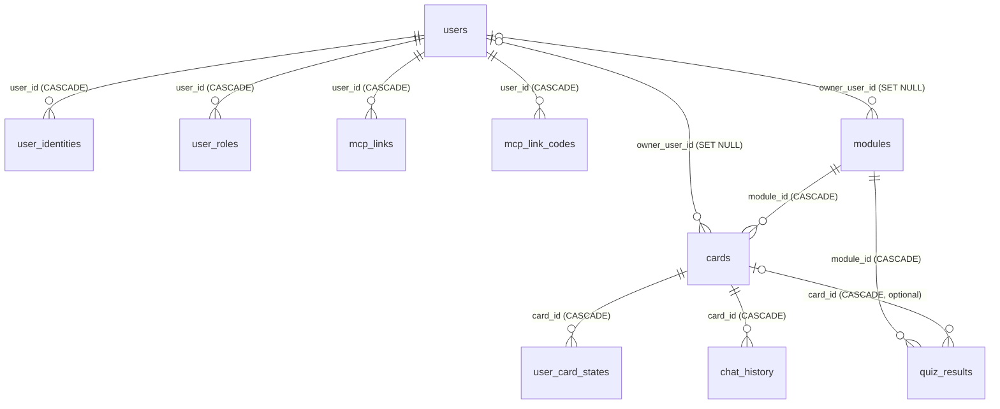

# Datenbankschema (PostgreSQL)

PostgreSQL ist die Referenz- und Produktionsdatenbank (Docker, Azure, IIS); SQLite dient nur der lokalen Entwicklung
([ADR 0004](adr/0004-datenbank-abstraktion.md)). Die Quelle der Wahrheit ist
[Schema.cs](../src/LearnCards.Web/Data/Schema.cs) plus die Migrationen in
[PostgresDatabase.cs](../src/LearnCards.Web/Data/PostgresDatabase.cs) (`InitAsync`).

## Überblick: was ist benutzerbezogen?

- **Benutzerbezogen (privat):** `modules` und `cards` (Eigentümer `owner_user_id`), `user_preferences`, `user_card_states`, `chat_history`, `quiz_results` (je `user_sub`), `mcp_links`.
- **Benutzerverwaltung:** `users`, `user_identities`, `user_roles`, `audit_log`.
- **Global geteilt:** nichts — es gibt keinen gemeinsamen Kartenbestand. Unzugeordneter Altbestand (`owner_user_id IS NULL`) ist nur für Administratoren sichtbar.
- Bewertung der Trennung: [Prüfbericht](reviews/2026-10-24-mehrbenutzer-pruefbericht.md).

## Konventionen

- IDs sind `UUID` (SQLite: `TEXT`), serverseitig als Guid-String erzeugt.
- Zeitstempel sind **ISO-8601-Text** (`yyyy-MM-ddTHH:mm:ss.fffZ`, UTC), keine `timestamptz`-Spalten.
- Booleans sind `INTEGER` 0/1; JSON-Inhalte liegen als `TEXT` (kein `jsonb`).
- Alle Werte laufen im Text-Wireformat (`DbValue`); Parameter immer als `@name` gebunden.
- `user_sub` enthält seit [ADR 0011](adr/0011-mehrbenutzerarchitektur.md) die **interne Benutzer-ID** (`users.id`), **ohne** Fremdschlüssel.
  Vor ADR 0011 stand dort das externe IdP-Subject; Altdaten werden beim ersten Login der Identität umgeschrieben.
- `owner_user_id` (Module, Karten) ist `NULL` für unzugeordneten Altbestand; dieser ist nur für Administratoren sichtbar.

## ER-Diagramm

`user_preferences` und `audit_log` haben keine Fremdschlüssel (Benutzerbezug über `user_sub` bzw. `actor_user_id` als Text).

## Tabellen

### users
Anwendungsbenutzer mit stabiler interner ID ([ADR 0011](adr/0011-mehrbenutzerarchitektur.md)).

| Spalte | Typ | Hinweis |
|---|---|---|
| id | UUID PK | interne Benutzer-ID (Claim `uid`) |
| display_name | TEXT NOT NULL | vom Benutzer änderbar |
| email | TEXT NOT NULL | Default `''`, vom IdP übernommen |
| status | TEXT NOT NULL | `active` oder `disabled` |
| legacy_migrated | INTEGER NOT NULL | 1 = Altdaten (`user_sub` = externes Subject) wurden auf diese ID umgeschrieben |
| created_at, last_login_at | TEXT NOT NULL | |

### user_identities
| Spalte | Typ | Hinweis |
|---|---|---|
| provider | TEXT NOT NULL | OIDC-Issuer-URL oder `dev` — Teil des PK |
| subject | TEXT NOT NULL | IdP-`sub` — Teil des PK |
| user_id | UUID NOT NULL | FK → users, `CASCADE` |
| created_at | TEXT NOT NULL | |

Index: `ix_user_identities_user (user_id)`.

### user_roles
| Spalte | Typ | Hinweis |
|---|---|---|
| user_id | UUID NOT NULL | FK → users, `CASCADE` — Teil des PK |
| role | TEXT NOT NULL | `user`, `admin` oder `auditor` — Teil des PK |
| granted_by | TEXT NULL | Benutzer-ID des Vergebenden, `bootstrap` (ADMIN_SUBJECTS) oder `idp` (Entra-App-Rolle, [ADR 0012](adr/0012-rollen-aus-entra-app-roles.md)) |
| granted_at | TEXT NOT NULL | |

### mcp_links
Benutzergebundene MCP-Zugänge ([ADR 0013](adr/0013-mcp-benutzergebundene-anmeldung.md)). Das Token selbst wird nie gespeichert.

| Spalte | Typ | Hinweis |
|---|---|---|
| id | UUID PK | |
| user_id | UUID NOT NULL | FK → users, `CASCADE`; Index `ix_mcp_links_user` |
| name | TEXT NOT NULL | Clientname bzw. frei gewählter Name |
| kind | TEXT NOT NULL | `oauth` oder `token` |
| token_hash | TEXT NOT NULL UNIQUE | SHA-256 (hex) des Tokens `lcm_…` |
| token_hint | TEXT NOT NULL | letzte Zeichen zur Wiedererkennung (`…ab12`) |
| created_at, expires_at | TEXT NOT NULL | |
| last_used_at, revoked_at | TEXT NULL | Widerruf setzt `revoked_at` |

### mcp_link_codes
Einmalige Übergabecodes der Zustimmung (5 Minuten gültig, Tausch nur durch den MCP-Server mit Dienstschlüssel).

| Spalte | Typ | Hinweis |
|---|---|---|
| code_hash | TEXT PK | SHA-256 (hex) des Codes |
| user_id | UUID NOT NULL | FK → users, `CASCADE` — der zustimmende Benutzer |
| client_name | TEXT NOT NULL | |
| created_at, expires_at | TEXT NOT NULL | |
| used_at | TEXT NULL | gesetzt beim Tausch (atomar, einmalig) |

### audit_log
Protokoll administrativer Aktionen (Rollen, Sperren, Zuweisung, Benutzeranlage).

| Spalte | Typ | Hinweis |
|---|---|---|
| id | UUID PK | |
| actor_user_id | TEXT NULL | NULL = System/Bootstrap |
| action | TEXT NOT NULL | z. B. `role.grant`, `role.revoke`, `user.disable`, `module.assign-owner` |
| target | TEXT NOT NULL | betroffene ID |
| detail | TEXT NOT NULL | |
| created_at | TEXT NOT NULL | Index `ix_audit_log_created` |

### modules
| Spalte | Typ | Hinweis |
|---|---|---|
| id | UUID PK | |
| name | TEXT NOT NULL UNIQUE | |
| description | TEXT NOT NULL | Default `''` |
| icon | TEXT NOT NULL | Default `📚` |
| color | TEXT NOT NULL | Default `#2AA79B` |
| owner_user_id | UUID NULL | FK → users, `SET NULL`; NULL = unzugeordneter Altbestand |
| created_at, updated_at | TEXT NOT NULL | ISO-8601 |

`name` ist nur pro Eigentümer eindeutig (Index `ux_modules_owner_name (owner_user_id, name)`), nicht mehr global. Index: `ix_modules_owner`.

### cards
| Spalte | Typ | Hinweis |
|---|---|---|
| id | UUID PK | |
| module_id | UUID NOT NULL | FK → modules, `ON DELETE CASCADE` |
| owner_user_id | UUID NULL | FK → users, `SET NULL`; entspricht dem Eigentümer des Moduls |
| category, term, question, definition | TEXT NOT NULL | |
| how_it_works, context, key_fact | TEXT NOT NULL | Default `''` |
| reference_answer | TEXT NOT NULL | Default `''` — Musterlösung |
| chat_prompt | TEXT NOT NULL | Default `''` |
| official_sources_json | TEXT NOT NULL | Default `'[]'` — Liste `{title,url,publisher}` |
| slide_number | INTEGER NULL | Folienmodus ([ADR 0010](adr/0010-folienmodus-und-karten-quiz.md)) |
| target_time_sec | INTEGER NULL | Zeitziel pro Folie |
| quiz_json | TEXT NOT NULL | Default `'[]'` — statisches Karten-Quiz |
| archived | INTEGER NOT NULL | Default 0 — Soft-Delete |
| sort_order | INTEGER NOT NULL | Default 0 |
| created_at, updated_at | TEXT NOT NULL | |

Indizes: `ix_cards_module (module_id)`, `ix_cards_category (module_id, category)`, `ix_cards_owner (owner_user_id)`.

### user_preferences
| Spalte | Typ | Hinweis |
|---|---|---|
| user_sub | TEXT PK | |
| theme | TEXT NOT NULL | Default `''` |
| updated_at | TEXT NOT NULL | |

### user_card_states
Lernstatus pro Benutzer und Karte.

| Spalte | Typ | Hinweis |
|---|---|---|
| user_sub | TEXT NOT NULL | Teil des PK |
| card_id | UUID NOT NULL | Teil des PK, FK → cards, `CASCADE` |
| is_checked | INTEGER NOT NULL | Default 0 |
| marked_review | INTEGER NOT NULL | Default 0 |
| updated_at | TEXT NOT NULL | |

Index: `ix_user_card_states_user (user_sub, card_id)`.

### chat_history
| Spalte | Typ | Hinweis |
|---|---|---|
| id | UUID PK | |
| user_sub | TEXT NOT NULL | |
| card_id | UUID NOT NULL | FK → cards, `CASCADE` |
| original_question, normalized_question, assistant_answer | TEXT NOT NULL | Default `''` |
| created_at | TEXT NOT NULL | |

Index: `ix_chat_history_user_card (user_sub, card_id, created_at)`.

### quiz_results
| Spalte | Typ | Hinweis |
|---|---|---|
| id | UUID PK | |
| module_id | UUID NOT NULL | FK → modules, `CASCADE` |
| card_id | UUID NULL | FK → cards, `CASCADE`; gesetzt bei Einzelkarten-Quiz |
| user_sub | TEXT NOT NULL | |
| category | TEXT NOT NULL | |
| score, max_score | DOUBLE PRECISION NOT NULL | |
| grade | TEXT NOT NULL | |
| feedback | TEXT NOT NULL | Default `''` |
| answers_json | TEXT NOT NULL | Default `'[]'` |
| stats_json | TEXT NOT NULL | Default `'{}'` |
| completed_at | TEXT NOT NULL | |

Index: `ix_quiz_user (user_sub, completed_at)`.

## Schema-Initialisierung und Migrationen

Beim Start (`PostgresDatabase.InitAsync`, serialisiert über ein Gate):

1. `Schema.Statements("postgres")` — alle `CREATE TABLE/INDEX IF NOT EXISTS`.
2. `MigrateLegacySchemaAsync` — `cards.archived` von `boolean` auf `INTEGER`.
3. `MigrateCardContentColumnsAsync` — ergänzt fehlende Spalten `reference_answer`, `official_sources_json`, `slide_number`, `target_time_sec`, `quiz_json`.
4. `MigrateQuizResultColumnsAsync` — ergänzt `quiz_results.card_id`, `stats_json`.
5. `MigrateModuleDeleteCascadeAsync` — stellt `ON DELETE CASCADE` auf den Modul-Fremdschlüsseln sicher.
6. `MigrateOwnershipAsync` ([ADR 0011](adr/0011-mehrbenutzerarchitektur.md)) — ergänzt `owner_user_id` an `modules`/`cards`, entfernt den Constraint
   `modules_name_key` und legt die Besitz-Indizes an (`Schema.OwnershipIndexStatements`, bewusst nach den Spaltenmigrationen).

Bestehende Zeilen behalten `owner_user_id = NULL`; es wird **nie automatisch** ein Eigentümer vergeben. Die Zuweisung erfolgt durch einen Administrator
(`/admin`). Die Umschreibung von `user_sub` (externes Subject → interne ID) geschieht beim ersten Login der Identität in `UserService.SignInAsync`.

**Rückfall:** Datenbank vor dem Rollout sichern (`pg_dump`). Die Migration löscht nichts; neue Tabellen/Spalten können bei einem Rollback ungenutzt bleiben.
Nach der Umschreibung enthält `user_sub` interne IDs — die Vorversion würde diese Daten nicht mehr dem alten Benutzer zuordnen.

Es gibt **kein Migrationsframework und keine Versionstabelle**: Jede Migration prüft per `information_schema` bzw. `pg_constraint`,
ob sie nötig ist, und muss daher idempotent sein. Ablauf für eine neue Spalte: [ADR 0004](adr/0004-datenbank-abstraktion.md).
Analoge Spaltenergänzungen für SQLite stehen in `SqliteDatabase.InitAsync` (`EnsureColumn`); `SqliteDatabase.MigrateOwnership` baut zusätzlich `modules`
im 12-Schritte-Verfahren neu auf (Inline-`UNIQUE` auf `name` ist per `ALTER` nicht entfernbar).

## Betrieb

- Verbindung per eigenem Wire-Protokoll v3 (SCRAM-SHA-256/MD5/Cleartext), `POSTGRES_SSLMODE` = `disable | prefer | require`
  (Azure: `require`); eine Verbindung, serialisiert, mit einmaligem Reconnect bei Verbindungsverlust.
- Docker: Image `postgres:16-alpine`, Volume `postgres_data`. Konfiguration über `POSTGRES_HOST/PORT/USER/PASSWORD/DB`.
- Backup/Restore liegt außerhalb der Anwendung (`pg_dump` auf Datenbankebene).
